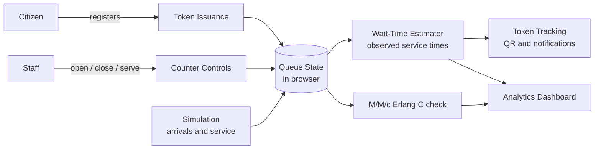

<div align="center">


**Digital tokens, live wait-time estimates, counter controls and queueing-theory analytics for public service desks.**

[Live Demo](#live-demo) · [Features](#features) · [How It Works](#how-it-works) · [Quick Start](#quick-start) · [Roadmap](#roadmap)

</div>

---

## Table of Contents

- [Overview](#overview)
- [Live Demo](#live-demo)
- [Team and Contributions](#team-and-contributions)
- [Features](#features)
- [Tech Stack](#tech-stack)
- [How It Works](#how-it-works)
- [Wait-Time Estimation](#wait-time-estimation)
- [Analytics](#analytics)
- [Quick Start](#quick-start)
- [Deployment](#deployment)
- [Demo Walkthrough](#demo-walkthrough)
- [Scope and Limitations](#scope-and-limitations)
- [Roadmap](#roadmap)
- [Challenges](#challenges)
- [AI and Open-Source Disclosure](#ai-and-open-source-disclosure)

---

## Overview

Long and unpredictable queues at hospitals, banks and government counters waste citizens' time and make it hard for staff to manage demand. **Queue Desk** is a browser-based prototype built for **Hackathon Track SC-03** that shows how digital tokens, transparent waiting-time estimates and simple staff controls can reduce that uncertainty.

| | Without Queue Desk | With Queue Desk |
|---|---|---|
| **Citizen** | Stands in line with no idea how long it will take | Gets a digital token, sees position and estimated wait |
| **Staff** | Reacts to crowding after it happens | Sees queue length and workload, and opens counters on demand |
| **Management** | No data on waiting or service times | Analytics on waits, service times and estimate accuracy |

---

## Live Demo

| Resource | Link |
|---|---|
| Application | `https://queue-desk.netlify.app/` |
| Demo video | `<paste video link>` |
| Presentation | `<paste PPT link>` |
| Repository | `https://github.com/MuhammadUzair-001/Queue-Desk` |


---

## Team and Contributions

**Team name:** `<registered team name>` · **Problem:** SC-03, Public Service Queue and Wait-Time Optimizer

| Member | GitHub | Contribution |
|---|---|---|
| Saqlain Abbas | [Saqlain-Soc](https://github.com/Saqlain-Soc) | `<what you built, e.g. estimation logic, analytics, README>` |
| Muhammad Uzair | [MuhammadUzair-001](https://github.com/MuhammadUzair-001) | `<what he built, e.g. UI, staff dashboard, deployment>` |

> Fill in the contribution column honestly. Judges may ask each member to explain their part.

---

## Features

| Area | Capability |
|---|---|
| **Token issuance** | Register a visitor and issue a queue token from the web interface |
| **Queue tracking** | Look up a token to see its status, position and estimated wait |
| **Staff dashboard** | Manage service counters and the token-serving workflow |
| **Counter controls** | Open and close counters and observe the effect on the queue immediately |
| **Simulation** | Simulate customer arrivals and service activity to demonstrate demand spikes |
| **Wait estimation** | Estimates based on queue conditions, counter availability and observed service times |
| **Queueing theory** | M/M/c (Erlang C) comparison to reason about staffing |
| **Analytics** | Queue length, completed tokens, average wait and service times, counter workload, estimate accuracy |
| **QR code** | Display a QR code that opens a token-status page |
| **Notifications** | Browser notifications for queue alerts, where supported and permitted |
| **Multilingual** | English and Urdu interface |
| **Accessibility** | Text-size controls and voice-related features for easier understanding |

---

## Tech Stack

| Layer | Technology | Purpose |
|---|---|---|
| Structure |  | Application markup |
| Styling |  | Responsive interface |
| Logic |  | Queue logic, simulation, estimates, dashboard and analytics |
| Browser APIs |  | Notifications and voice/accessibility features |
| QR codes | -111827?style=flat-square) | Token-status QR generation |
| Hosting |  | Static deployment |

---

## How It Works



1. A citizen registers and receives a token.
2. The queue state is updated as tokens are issued, called and served.
3. Staff open or close counters, and the estimator recalculates waits.
4. The analytics view compares estimates with completed service outcomes.

---

## Wait-Time Estimation

The estimator considers the waiting line, the number of available counters and observed service-time information. Estimates are compared with completed service outcomes to measure accuracy.

As a reference, the app includes an **M/M/c (Erlang C)** comparison:

```text
M/M/c model
  lambda = arrival rate
  mu     = service rate per counter
  c      = number of open counters
  rho    = lambda / (c x mu)   (system is stable when rho < 1)
```

> These outputs are estimates, not guarantees. Actual waits vary with arrivals, service durations and counter availability.

---

## Analytics

| Metric | What it shows |
|---|---|
| Queue length | People currently waiting |
| Completed tokens | Throughput so far |
| Average waiting time | Time from token issue to service start |
| Average service time | Time spent at the counter |
| Counter workload | How evenly work is spread across counters |
| Estimate accuracy | How close predicted waits were to actual waits |

---

## Quick Start

### Option 1: Open directly

```bash
git clone https://github.com/MuhammadUzair-001/Queue-Desk.git
cd Queue-Desk
```

Open `index.html` in a modern browser.

### Option 2: Local server

```bash
python -m http.server 8000
```

Then visit `http://localhost:8000`.

> Notifications and microphone features may require a secure context (`localhost` or HTTPS) and user permission.

### Project structure

```text
Queue-Desk/
├── index.html    # Complete app: HTML, CSS and JavaScript
└── README.md     # Documentation
```

---

## Deployment

The project is a static site and can be hosted on GitHub Pages.

| Step | Action |
|---|---|
| 1 | Make sure the main file is named `index.html` |
| 2 | Upload `index.html` and `README.md` to the repository root |
| 3 | Open **Settings, Pages** |
| 4 | Select branch `main` and folder `/ (root)` |
| 5 | Save and wait for the site to publish |

> Uploading a ZIP file alone does not publish the app. Extract it and upload the actual files.

---

## Demo Walkthrough

| Step | Action | What to observe |
|---|---|---|
| 1 | Open the citizen interface and issue a token | Token number and queue position |
| 2 | Track the token | Estimated wait |
| 3 | Open the staff dashboard and serve the next token | Queue advances |
| 4 | Open or close a counter | Estimates change immediately |
| 5 | Increase the simulated arrival rate | Wait times rise during the demand spike |
| 6 | Review analytics | Completed tokens, average waits, workload |
| 7 | Switch to Urdu and try accessibility controls | Interface language and text size |

---

## Scope and Limitations

| Limitation | Detail |
|---|---|
| Client-side prototype | Not a production multi-user queue service |
| No shared queue | Queue state lives in the browser, so separate visitors do not share a live queue |
| No persistence or auth | No server storage, user accounts or staff login |
| Browser dependent | Notifications and voice features depend on browser support and permissions |
| CDN dependency | The QR library loads from a CDN and needs an internet connection |

---

## Roadmap

- [ ] Backend API with a persistent database
- [ ] Real-time sync across citizen and staff devices
- [ ] Secure staff login with role-based permissions
- [ ] Reliable notifications when a token nears the front
- [ ] Evaluate wait-time prediction against real service data
- [ ] Automated tests, deployment checks and monitoring

---

## Challenges

| Challenge | How it was handled |
|---|---|
| Estimating waits when demand changes | Combined queue length, open counters and observed service times, then compared with M/M/c |
| Showing the effect of staffing quickly | Counter controls and a simulator that recalculate estimates instantly |
| No shared backend in 24 hours | Kept state client-side and documented it as a limitation |
| `<add your own challenge>` | `<how you solved it>` |

---

## AI and Open-Source Disclosure

| Item | Usage | Where |
|---|---|---|
| Claude (Anthropic) | `<e.g. drafting README, code assistance. Edit to match what you really did>` | `<files / parts>` |
| `<other AI tool, if any>` | `<usage>` | `<where>` |
| QR code library (CDN) | Generates the token-status QR code | `index.html` |
| Browser Web APIs | Notifications and voice features | `index.html` |

> List every AI tool and library you actually used. Do not include secrets or API keys in the repository.

---

## Hackathon Track

**SC-03: Public Service Queue and Wait-Time Optimizer**

The project demonstrates a digital approach to reducing uncertainty in public-service queues and helping staff see how counter availability and changing demand affect waiting times.

---

## License

Created for a hackathon. No formal open-source license is specified yet; confirm preferred terms before redistributing.

<div align="center">

**Queue Desk: smarter queues, less waiting, better public services.**


</div>
